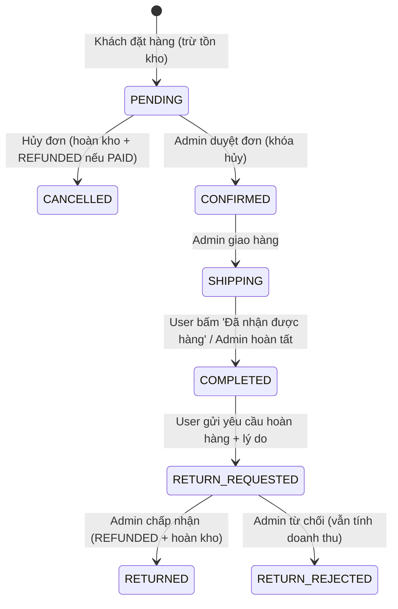

# Luồng Nghiệp Vụ & Quy Tắc Xử Lý (Business Rules)

## 1. Quản lý Giỏ hàng (Session Cart)
- Giỏ hàng lưu trong `req.session.cart` dưới dạng mảng các object: `{ bookId, title, price, cover_image, quantity }`.
- Khi thêm sách hoặc tăng số lượng, `cartController` gọi `bookService.validateBookStock()` kiểm tra: nếu `quantity > book.stock`, hệ thống chặn thao tác và báo lỗi *"Số lượng vượt quá tồn kho hiện có"*.

## 2. Quy trình Đặt hàng & Strategy Pattern Thanh toán (`COD` / `VIETQR`)
Khi khách bấm **"Xác nhận đặt hàng"** (`POST /checkout`):
1. `authMiddleware.requireLogin` kiểm tra đăng nhập.
2. `orderService.createOrder()` mở một **PostgreSQL Transaction** (`withTransaction`):
   - Khóa dòng sách bằng `SELECT ... FOR UPDATE` và kiểm tra lại tồn kho thực tế. Nếu không đủ hàng → Rollback và báo lỗi.
   - Tạo bản ghi `orders` với `status = 'PENDING'`.
   - Khởi tạo `PaymentContext.fromMethod(payment_method)`:
     - **`CodStrategy`**: gán `payment_status = 'UNPAID'`, `transaction_code = null`, điều hướng về `/orders/:id`.
     - **`VietQrStrategy`**: sinh mã giao dịch duy nhất `DH<orderId><4 số ngẫu nhiên>`, sinh URL ảnh QR động VietQR (`img.vietqr.io`), lưu `transaction_code` và điều hướng về `/orders/:id/payment`.
   - Lưu từng sản phẩm vào `order_items` kèm `unit_price` hiện tại và trừ `books.stock`.
3. Commit Transaction → Xóa `req.session.cart` → Điều hướng theo chiến lược thanh toán.

### Luồng xác nhận VietQR
- Trang `GET /orders/:id/payment` hiển thị ảnh QR động, thông tin ngân hàng MB Bank, số tiền, nút Copy nội dung chuyển khoản và tự động gọi `GET /orders/:id/payment-status` mỗi **3 giây**.
- Nút **"Giả lập ngân hàng báo đã nhận tiền (Demo)"** gọi `POST /api/payment/webhook` cập nhật `payment_status = 'PAID'` và chuyển thẳng sang trang theo dõi đơn hàng `/orders/:id`.

## 3. Theo dõi Đơn hàng 4 bước & Đồng bộ với Admin
- Vòng đời đơn hàng gồm 4 bước chính: `PENDING` (Chờ xác nhận) → `CONFIRMED` (Đã xác nhận) → `SHIPPING` (Đang giao hàng) → `COMPLETED` (Hoàn thành — khi User bấm **"Đã nhận được hàng"** hoặc Admin hoàn tất), hoặc `CANCELLED` (Đã hủy).
- Khách hàng truy cập **Đơn hàng của tôi** (`/orders`) và chi tiết theo dõi (`/orders/:id`) để xem Stepper 4 bước, badge trạng thái thanh toán (`Đã thanh toán` / `Chưa thanh toán`), nút **Quét QR thanh toán ngay** (nếu `VIETQR` + `UNPAID`), nút **Hủy đơn hàng** (nếu `PENDING`) và nút **"Đã nhận được hàng"** (`POST /orders/:id/confirm-received` khi `status === 'SHIPPING'`).
- Khi khách hàng bấm **"Đã nhận được hàng"**, hệ thống kiểm tra quyền sở hữu `user_id` và trạng thái `SHIPPING`, cập nhật `status = 'COMPLETED'` (nếu `payment_method === 'COD'` thì đồng thời cập nhật `payment_status = 'PAID'`), thanh tiến trình nhảy sang bước cuối và đồng bộ ngay với trang quản lý Admin.
- Trang `/orders/:id` tự động polling `GET /orders/:id/status` mỗi **5 giây** để đồng bộ ngay lập tức khi Admin duyệt hoặc chuyển trạng thái đơn.

## 4. Quy trình Hủy đơn, Hoàn tiền (`REFUNDED`) & Hoàn tồn kho
- **Điều kiện khóa hủy đơn:** Chỉ cho phép hủy đơn hàng khi `order.status === 'PENDING'` (áp dụng cho cả Khách hàng và Admin). Sau khi Admin đã duyệt sang `CONFIRMED`, `SHIPPING` hoặc `COMPLETED`, giao diện ẩn hoàn toàn nút Hủy đơn và tầng Service (`orderService.cancelOrder()`) sẽ ném lỗi *"Đơn hàng đã được xác nhận, không thể hủy"*.
- **Nghiệp vụ hoàn tiền & hoàn kho (Transaction):**
  - Cập nhật `orders.status = 'CANCELLED'`.
  - Nếu `order.payment_status === 'PAID'` (ví dụ đơn VietQR đã thanh toán), hệ thống tự động cập nhật `payment_status = 'REFUNDED'` (hiển thị Badge **Đã hoàn tiền (VIETQR)**). Nếu là `'UNPAID'` thì giữ nguyên `'UNPAID'`.
  - Cộng trả lại toàn bộ `quantity` vào cột `stock` của từng cuốn sách trong `order_items`.

## 4.1. Luồng Hoàn hàng / Trả hàng (Return & Refund)
- **Phía Khách hàng:** Khi đơn hàng ở trạng thái `COMPLETED`, nút **"Yêu cầu hoàn hàng"** hiển thị tại `/orders` và `/orders/:id`. Khách nhập lý do hoàn hàng (`return_reason`) và gửi `POST /orders/:id/request-return` → `status` chuyển thành `RETURN_REQUESTED`.
- **Phía Admin:** Tại `/admin/orders` và `/admin/orders/:id`, các đơn `RETURN_REQUESTED` được làm nổi bật kèm lý do hoàn hàng và 2 nút xử lý:
  - **"Chấp nhận hoàn hàng"** (`POST /admin/orders/:id/approve-return`): chạy Transaction chuyển `status = 'RETURNED'`, `payment_status = 'REFUNDED'` và cộng hoàn lại `stock` vào bảng `books`.
  - **"Từ chối hoàn hàng"** (`POST /admin/orders/:id/reject-return`): chuyển `status = 'RETURN_REJECTED'`.
- **Thống kê doanh thu Dashboard:** Chỉ cộng doanh thu từ các đơn `COMPLETED` và `RETURN_REJECTED` (loại trừ hoàn toàn `RETURNED` và `CANCELLED`).

## 5. Phân quyền, Tách bạch Giao diện & Bảo vệ Route Admin
- Mọi route bắt đầu bằng `/admin` đều phải đi qua 2 lớp bảo vệ: `requireLogin` → `requireAdmin` (`req.session.user.role === 'admin'`).
- **Tách bạch giao diện Admin & Client:** Khi tài khoản đang đăng nhập có `role === 'admin'`, thanh Header tự động ẩn hoàn toàn icon **Giỏ hàng** và nút **"Đơn hàng của tôi"**, chỉ hiển thị nút **"Trang quản trị"** (`/admin`).
- Khu vực `/admin` tập trung vào **Dashboard thống kê bán hàng** (Doanh thu, Số lượng sách đã bán, Sách đang kinh doanh, Cảnh báo tồn kho thấp &le; 10) và **Quản lý Sách / Danh mục** (thêm, sửa, cập nhật tồn kho, ẩn/hiện sách) cùng quản lý đơn hàng đồng bộ.
- Không xóa cứng (`DELETE`) sách đã từng có trong `order_items` để bảo toàn lịch sử hóa đơn; chỉ cập nhật `is_active = 0` để ẩn khỏi trang bán hàng.

## 6. Luồng Quên mật khẩu & Xác thực OTP qua Email (`nodemailer`)
1. Tại trang Đăng nhập (`GET /login`), người dùng bấm **"Quên mật khẩu?"** để chuyển tới `GET /forgot-password`.
2. Người dùng nhập email đã đăng ký (`POST /forgot-password`):
   - `authService.requestPasswordReset()` kiểm tra email tồn tại trong bảng `users` trên Supabase.
   - Sinh mã **OTP gồm 6 chữ số** có hiệu lực **5 phút** và lưu `{ email, otp, expiresAt }` vào `req.session.passwordReset`.
   - Gửi email qua `nodemailer` sử dụng `SMTP_EMAIL` và `SMTP_PASS` trong `.env`. Nếu chưa cấu hình SMTP, hệ thống tự động in mã OTP ra **console server** (cơ chế dự phòng cho môi trường phát triển/demo).
3. Người dùng nhập mã OTP và mật khẩu mới tại `GET /reset-password` → gửi `POST /reset-password`:
   - `authService.resetPasswordWithOtp()` kiểm tra OTP khớp và chưa quá 5 phút.
   - Hash mật khẩu mới bằng `bcryptjs` (10 rounds), cập nhật `password_hash` vào bảng `users` trên Supabase, xóa `req.session.passwordReset` và chuyển về `/login`.
